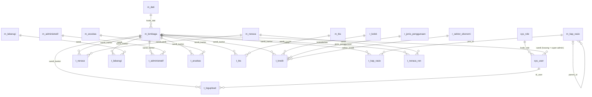
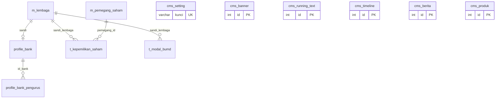

# 🗄️ Desain Database — SimpelkeuJabar

> Rancangan basis data untuk produk **SimpelkeuJabar** (Sistem Pelaporan Keuangan Jawa Barat). Disusun dari skema aktual (`information_schema`) DB lokal `simpelkeujabar_simpelku` dan dari kode aplikasi.

| Field             | Detail              |
|-------------------|---------------------|
| Produk            | SimpelkeuJabar      |
| Jenis Dokumen     | Desain Database     |
| Versi             | 1.0.0               |
| Tanggal Dibuat    | 11 Oktober 2026     |
| Status            | 🟡 Draft            |
| Disusun oleh      |                     |
| Direview oleh     |                     |
| Disetujui oleh    |                     |

---

## 0. Ikhtisar & Konteks

| Aspek | Detail |
|-------|--------|
| DBMS | MySQL / **Percona Server 5.7**, engine **InnoDB** |
| Nama DB | `simpelkeujabar_simpelku` (lokal & produksi) |
| Jumlah tabel | **47**: 2 akun, 9 master, 3 referensi kredit, 7 transaksi realisasi, 6 transaksi rencana, 6 log, 6 profil/saham, 7 CMS, 1 sistem Laravel |
| Pengelolaan skema | **Tidak memakai migration Laravel** untuk tabel domain. Skema awal berasal dari dump; penambahan dirilis sebagai **patch SQL** di `database/sql/` (lihat §6). |
| Foreign key | **Tidak ada FK yang dideklarasikan.** Seluruh relasi bersifat **logis** dan dijaga oleh kode aplikasi (lihat §3). |
| Collation | Mayoritas `latin1_swedish_ci`; `sys_user`, `sys_role`, `m_dati`, `migrations` `utf8mb4_unicode_ci`; `r_kolek` `utf8mb4_general_ci`. |
| Konvensi nama | `m_*` master, `r_*` referensi kode, `t_*` transaksi, `t_*_ren` rencana, `t_log*` log unggahan, `sys_*` akun, `cms_*` konten portal, `profile_bank*` profil. |
| Kunci tenant | `m_lembaga.sandi` (CHAR 6), disebut `sandi_kantor` / `sandi_lembaga` / `sandi` pada tabel lain. |

> **Catatan pembaca.** Jumlah baris di §1 adalah **perkiraan InnoDB** dari DB lokal (Okt 2026), hanya untuk gambaran skala. Angka ini bukan data produksi.

## 1. Daftar Tabel

| Kelompok | Tabel | ±Baris | Fungsi singkat |
|----------|-------|-------:|----------------|
| Akun | `sys_user` | 37 | Akun pengguna |
| | `sys_role` | 6 | Peran |
| Master lembaga | `m_lembaga` | 32 | Lembaga pelapor (tenant) |
| | `m_dati` | 550 | Kab/kota |
| Master COA | `m_neraca` | 56 | Pos Neraca |
| | `m_labarugi` | 110 | Pos Laba Rugi |
| | `m_administratif` | 20 | Pos Administratif |
| | `m_aruskas` | 4 | Pos Arus Kas |
| | `m_tks` | 16 | Rasio TKS |
| | `m_kap_rasio` | 20 | Pos Publikasi OJK |
| | `m_rekap` | 166 | Pos Rekap Keuangan Gabungan |
| Referensi kredit | `r_kolek` | 5 | Kolektibilitas |
| | `r_jenis_penggunaan` | 3 | Jenis penggunaan |
| | `r_sektor_ekonomi` | 10 | Sektor ekonomi |
| Realisasi | `t_neraca` | 87 rb | Neraca bulanan |
| | `t_labarugi` | 170 rb | Laba Rugi bulanan |
| | `t_administratif` | 30 rb | Administratif bulanan |
| | `t_aruskas` | 5 rb | Arus Kas bulanan |
| | `t_tks` | 21 rb | TKS bulanan |
| | `t_kredit` | 23 rb | Kredit bulanan |
| | `t_kap_rasio` | 40 | Publikasi OJK |
| Rencana | `t_neraca_ren` | 2,3 rb | Rencana Neraca |
| | `t_labarugi_ren` | 4,6 rb | Rencana Laba Rugi |
| | `t_administratif_ren` | 840 | Rencana Administratif |
| | `t_aruskas_ren` | 168 | Rencana Arus Kas |
| | `t_tks_ren` | 683 | Rencana TKS |
| | `t_kredit_ren` | 735 | Rencana Kredit |
| Log | `t_logupload` | 1,3 rb | Unggah data keuangan |
| | `t_logkajian` | 160 | Unggah Kajian Dekom |
| | `t_loghasilkap` | 8 | Unggah Hasil KAP |
| | `t_loggcg` | 11 | Unggah GCG |
| | `t_logrups` | 4 | Unggah RUPS |
| | `t_logjamkrida` | 5 | Unggah Laporan Jamkrida |
| Profil & saham | `profile_bank` | 31 | Profil lembaga |
| | `profile_bank_pengurus` | 124 | Direksi & komisaris |
| | `m_pemegang_saham` | 18 | Master pemegang saham |
| | `t_kepemilikan_saham` | 41 | Komposisi saham per lembaga |
| | `t_modal_bumd` | 32 | Modal Pemprov per tahun |
| | `m_saham` | 2 | Komposisi saham agregat *(tidak dipakai)* |
| CMS | `cms_setting` | 9 | Pengaturan situs |
| | `cms_banner` | 4 | Banner |
| | `cms_running_text` | 1 | Running text |
| | `cms_timeline` | 14 | Sejarah |
| | `cms_berita` | 2 | Berita |
| | `cms_produk` | 3 | Layanan & produk |
| | `cms_section` | 0 | Blok konten *(belum dipakai)* |
| Sistem | `migrations` | 0 | Bawaan Laravel |

## 2. Detail Tabel

Legenda kolom **Key**: `PK` primary key, `UQ` unique, `IDX` ter-index, `AI` auto increment.
Panah `→` menandai **relasi logis** (tidak ada constraint FK di DB).

### 2.1 Akun & Akses

#### `sys_user`

Akun pengguna aplikasi. Login memakai `email` + `password`. Status super-admin ditentukan dari `sandi` yang kosong.

| Kolom | Tipe | Null | Key | Default | Keterangan |
|-------|------|------|-----|---------|------------|
| `id` | bigint(20) | Tidak | PK AI |  |  |
| `kode_role` | varchar(2) | Tidak | IDX |  | → `sys_role.kode_role` |
| `sandi` | varchar(6) | Tidak | IDX |  | → `m_lembaga.sandi`; **kosong = super-admin** |
| `email` | varchar(50) | Tidak |  |  |  |
| `password` | varchar(150) | Tidak |  |  | Hash bcrypt |
| `nama_lengkap` | varchar(150) | Tidak |  |  |  |
| `tgl_register` | date | Tidak |  |  |  |
| `status` | tinyint(4) | Tidak |  | `0` | 1 = aktif / tampil, 0 = nonaktif |

Index: `sys_user_rkantor_kode_foreign` (sandi); `sys_user_sysrole_kode_foreign` (kode_role)

#### `sys_role`

Referensi peran: `00` Administrator, `01` Provinsi, `02` Bank, `03` LKM, `04` Jamkrida, `05` Guest.

| Kolom | Tipe | Null | Key | Default | Keterangan |
|-------|------|------|-----|---------|------------|
| `kode_role` | varchar(2) | Tidak | PK |  |  |
| `nama_role` | varchar(100) | Tidak |  |  |  |

### 2.2 Master Lembaga & Wilayah

#### `m_lembaga`

Daftar lembaga pelapor (BUMD keuangan). **Kunci tenant** seluruh aplikasi: `sandi` dirujuk oleh `sys_user.sandi`, `t_*.sandi_kantor`, `profile_bank.sandi`, dll.

| Kolom | Tipe | Null | Key | Default | Keterangan |
|-------|------|------|-----|---------|------------|
| `sandi` | char(6) | Tidak | PK |  |  |
| `nama` | varchar(100) | Ya |  |  |  |
| `jenis` | varchar(1) | Ya |  |  | 1 BPR, 2 LKM, 3 Jamkrida, 4 Bank Umum |
| `alamat` | varchar(255) | Ya |  |  |  |
| `kode_dati` | int(11) | Ya |  |  | → `m_dati.kode_dati` |
| `email` | varchar(50) | Ya |  |  |  |

#### `m_dati`

Referensi Daerah Tingkat II (kab/kota) untuk alamat lembaga.

| Kolom | Tipe | Null | Key | Default | Keterangan |
|-------|------|------|-----|---------|------------|
| `kode_dati` | int(11) | Tidak | PK |  |  |
| `nama_dati` | varchar(191) | Tidak |  |  |  |

### 2.3 Master Pos Laporan (COA)

#### `m_neraca`

Daftar pos Neraca (hierarki induk/detail). `1000000000` = Aset, `2000000000` = Kewajiban, `3000000000` = Ekuitas.

| Kolom | Tipe | Null | Key | Default | Keterangan |
|-------|------|------|-----|---------|------------|
| `sandi` | varchar(20) | Tidak | PK |  |  |
| `nama` | varchar(255) | Ya |  |  |  |
| `g_or_d` | varchar(1) | Ya |  |  | `G` = induk (grup/subtotal), `D` = detail |
| `level` | int(11) | Ya |  |  | Kedalaman hierarki (0 = paling atas) |

#### `m_labarugi`

Daftar pos Laba Rugi; `urutan` menentukan urutan cetak.

| Kolom | Tipe | Null | Key | Default | Keterangan |
|-------|------|------|-----|---------|------------|
| `sandi` | varchar(20) | Tidak | PK |  |  |
| `nama` | varchar(255) | Ya |  |  |  |
| `g_or_d` | varchar(1) | Ya |  |  | `G` = induk (grup/subtotal), `D` = detail |
| `level` | int(11) | Ya |  |  | Kedalaman hierarki (0 = paling atas) |
| `urutan` | int(11) | Ya |  |  | Urutan tampil (kecil → atas) |

#### `m_administratif`

Daftar pos Rekening Administratif.

| Kolom | Tipe | Null | Key | Default | Keterangan |
|-------|------|------|-----|---------|------------|
| `sandi` | varchar(20) | Tidak | PK |  |  |
| `nama` | varchar(255) | Ya |  |  |  |
| `g_or_d` | varchar(1) | Ya |  |  | `G` = induk (grup/subtotal), `D` = detail |
| `level` | int(11) | Ya |  |  | Kedalaman hierarki (0 = paling atas) |

#### `m_aruskas`

Daftar pos Arus Kas.

| Kolom | Tipe | Null | Key | Default | Keterangan |
|-------|------|------|-----|---------|------------|
| `sandi` | varchar(20) | Tidak | PK |  |  |
| `nama` | varchar(255) | Ya |  |  |  |
| `g_or_d` | varchar(1) | Ya |  |  | `G` = induk (grup/subtotal), `D` = detail |
| `level` | int(11) | Ya |  |  | Kedalaman hierarki (0 = paling atas) |

#### `m_tks`

Daftar rasio Tingkat Kesehatan (mis. `001` CAR, `002` NPL Gross, `004` KAP).

| Kolom | Tipe | Null | Key | Default | Keterangan |
|-------|------|------|-----|---------|------------|
| `sandi` | varchar(20) | Tidak | PK |  |  |
| `nama` | varchar(255) | Ya |  |  |  |

#### `m_kap_rasio`

Daftar pos Laporan Publikasi OJK (KAP & Rasio); hierarki via `parent_id`, `tipe` HEADER/DETAIL.

| Kolom | Tipe | Null | Key | Default | Keterangan |
|-------|------|------|-----|---------|------------|
| `id` | int(11) | Tidak | PK AI |  |  |
| `sandi` | varchar(20) | Tidak |  |  |  |
| `nama` | varchar(200) | Tidak |  |  |  |
| `parent_id` | int(11) | Ya |  |  | → `m_kap_rasio.id` (induk HEADER) |
| `tipe` | enum('HEADER','DETAIL') | Ya |  | `DETAIL` |  |
| `urutan` | int(11) | Tidak |  |  | Urutan tampil (kecil → atas) |

#### `m_rekap`

Pos ringkas untuk laporan **Rekap Keuangan Gabungan** (gabungan pos Neraca & Laba Rugi).

| Kolom | Tipe | Null | Key | Default | Keterangan |
|-------|------|------|-----|---------|------------|
| `sandi` | varchar(20) | Tidak | PK |  |  |
| `nama` | varchar(255) | Ya |  |  |  |
| `g_or_d` | varchar(1) | Ya |  |  | `G` = induk (grup/subtotal), `D` = detail |
| `level` | int(11) | Ya |  |  | Kedalaman hierarki (0 = paling atas) |
| `jenis` | varchar(255) | Ya |  |  | `NERACA` / `LABA RUGI` |

### 2.4 Referensi Kredit

#### `r_kolek`

Kolektibilitas kredit: L, DPK, KL, D, M (`urut` 1–5).

| Kolom | Tipe | Null | Key | Default | Keterangan |
|-------|------|------|-----|---------|------------|
| `kode` | char(3) | Tidak | PK |  |  |
| `nama` | varchar(50) | Ya |  |  |  |
| `urut` | int(11) | Ya |  |  |  |

#### `r_jenis_penggunaan`

Jenis penggunaan kredit: `10` Modal Kerja, `20` Investasi, `39` Konsumtif.

| Kolom | Tipe | Null | Key | Default | Keterangan |
|-------|------|------|-----|---------|------------|
| `kode` | char(3) | Tidak | PK |  |  |
| `deskripsi` | varchar(255) | Ya |  |  |  |

#### `r_sektor_ekonomi`

Sektor ekonomi kredit: PDG, PTN, PKN, PKB, INF, KSM, MKJ, IVS, ASN, NAS.

| Kolom | Tipe | Null | Key | Default | Keterangan |
|-------|------|------|-----|---------|------------|
| `kode` | char(3) | Tidak | PK |  |  |
| `deskripsi` | varchar(255) | Ya |  |  |  |

### 2.5 Transaksi Realisasi (bulanan)

#### `t_neraca`

Nilai pos Neraca per lembaga per periode. Sumber: sheet `Neraca` file Realisasi.

| Kolom | Tipe | Null | Key | Default | Keterangan |
|-------|------|------|-----|---------|------------|
| `id` | int(11) | Tidak | PK AI |  |  |
| `sandi` | varchar(20) | Ya |  |  |  |
| `nominal` | decimal(18,2) | Ya |  |  | Nilai dalam Rupiah |
| `periode` | date | Ya | IDX |  | Tanggal akhir bulan periode laporan |
| `sandi_kantor` | varchar(6) | Ya | IDX |  | Sandi lembaga pelapor → `m_lembaga.sandi` (logis) |

Index: `idx_neraca_kantor_periode_sandi` (sandi_kantor,periode,sandi); `idx_neraca_periode` (periode)

#### `t_labarugi`

Nilai pos Laba Rugi. Sumber: sheet `Laba Rugi`. Tabel terbesar (±170 rb baris).

| Kolom | Tipe | Null | Key | Default | Keterangan |
|-------|------|------|-----|---------|------------|
| `id` | int(11) | Tidak | PK AI |  |  |
| `sandi` | varchar(20) | Ya |  |  |  |
| `nominal` | decimal(18,2) | Ya |  |  | Nilai dalam Rupiah |
| `periode` | date | Ya | IDX |  | Tanggal akhir bulan periode laporan |
| `sandi_kantor` | varchar(6) | Ya | IDX |  | Sandi lembaga pelapor → `m_lembaga.sandi` (logis) |

Index: `idx_labarugi_kantor_periode_sandi` (sandi_kantor,periode,sandi); `idx_labarugi_periode` (periode)

#### `t_administratif`

Nilai pos Rekening Administratif. Sumber: sheet `Administratif`.

| Kolom | Tipe | Null | Key | Default | Keterangan |
|-------|------|------|-----|---------|------------|
| `id` | int(11) | Tidak | PK AI |  |  |
| `sandi` | varchar(20) | Ya |  |  |  |
| `nominal` | decimal(18,2) | Ya |  |  | Nilai dalam Rupiah |
| `periode` | date | Ya |  |  | Tanggal akhir bulan periode laporan |
| `sandi_kantor` | varchar(6) | Ya | IDX |  | Sandi lembaga pelapor → `m_lembaga.sandi` (logis) |

Index: `idx_adm_kantor_periode` (sandi_kantor,periode)

#### `t_aruskas`

Nilai pos Arus Kas. Sumber: sheet `Arus Kas`.

| Kolom | Tipe | Null | Key | Default | Keterangan |
|-------|------|------|-----|---------|------------|
| `id` | int(11) | Tidak | PK AI |  |  |
| `sandi` | varchar(12) | Ya |  |  |  |
| `nominal` | decimal(18,2) | Ya |  |  | Nilai dalam Rupiah |
| `periode` | date | Ya |  |  | Tanggal akhir bulan periode laporan |
| `sandi_kantor` | varchar(6) | Ya | IDX |  | Sandi lembaga pelapor → `m_lembaga.sandi` (logis) |

Index: `idx_aruskas_kantor_periode` (sandi_kantor,periode)

#### `t_tks`

Nilai rasio Tingkat Kesehatan. Sumber: sheet `TKS`.

| Kolom | Tipe | Null | Key | Default | Keterangan |
|-------|------|------|-----|---------|------------|
| `id` | int(11) | Tidak | PK AI |  |  |
| `sandi` | varchar(12) | Ya |  |  |  |
| `nominal` | decimal(18,2) | Ya |  |  | Nilai dalam Rupiah |
| `periode` | date | Ya |  |  | Tanggal akhir bulan periode laporan |
| `sandi_kantor` | varchar(6) | Ya | IDX |  | Sandi lembaga pelapor → `m_lembaga.sandi` (logis) |

Index: `idx_tks_kantor_periode_sandi` (sandi_kantor,periode,sandi)

#### `t_kredit`

Baki debet kredit per kolektibilitas × jenis penggunaan × sektor. Sumber: sheet `Kredit`.

| Kolom | Tipe | Null | Key | Default | Keterangan |
|-------|------|------|-----|---------|------------|
| `id` | int(11) | Tidak | PK AI |  |  |
| `kolektibilitas` | varchar(50) | Ya | IDX |  | Kode → `r_kolek.kode` (L/DPK/KL/D/M) |
| `jenis_penggunaan` | varchar(50) | Ya |  |  | Kode → `r_jenis_penggunaan.kode` (10/20/39) |
| `sektor_kredit` | char(3) | Ya | IDX |  | Kode → `r_sektor_ekonomi.kode` |
| `nominal` | decimal(18,2) | Ya |  |  | Nilai dalam Rupiah |
| `jml_org` | bigint(20) | Ya |  |  | Jumlah debitur |
| `periode` | date | Ya | IDX |  | Tanggal akhir bulan periode laporan |
| `sandi_kantor` | varchar(6) | Ya | IDX |  | Sandi lembaga pelapor → `m_lembaga.sandi` (logis) |

Index: `idx_kolektibilitas` (kolektibilitas); `idx_kredit_kantor_periode` (sandi_kantor,periode); `idx_periode` (periode); `idx_sektor_kredit` (sektor_kredit)

#### `t_kap_rasio`

Nilai Laporan Publikasi OJK per pos, dipecah per kolektibilitas. Sumber: sheet `KapRasio`.

| Kolom | Tipe | Null | Key | Default | Keterangan |
|-------|------|------|-----|---------|------------|
| `id` | bigint(20) | Tidak | PK AI |  |  |
| `periode` | date | Tidak |  |  | Tanggal akhir bulan periode laporan |
| `sandi_kantor` | varchar(6) | Tidak | IDX |  | Sandi lembaga pelapor → `m_lembaga.sandi` (logis) |
| `pos_id` | int(11) | Tidak |  |  | Pos → `m_kap_rasio.id` |
| `l` | decimal(20,2) | Ya |  | `0.00` | Lancar |
| `dpk` | decimal(20,2) | Ya |  | `0.00` | Dalam Perhatian Khusus |
| `kl` | decimal(20,2) | Ya |  | `0.00` | Kurang Lancar |
| `d` | decimal(20,2) | Ya |  | `0.00` | Diragukan |
| `m` | decimal(20,2) | Ya |  | `0.00` | Macet |
| `jumlah` | decimal(20,2) | Ya |  | `0.00` | Total |

Index: `idx_kaprasio_kantor_periode` (sandi_kantor,periode)

### 2.6 Transaksi Rencana / Target (RBB, tahunan)

#### `t_neraca_ren`

Rencana Neraca. Struktur sama dengan `t_neraca`.

| Kolom | Tipe | Null | Key | Default | Keterangan |
|-------|------|------|-----|---------|------------|
| `id` | int(11) | Tidak | PK AI |  |  |
| `sandi` | varchar(20) | Ya |  |  |  |
| `nominal` | decimal(18,2) | Ya |  |  | Nilai dalam Rupiah |
| `periode` | date | Ya |  |  | Tanggal akhir bulan periode laporan |
| `sandi_kantor` | varchar(6) | Ya | IDX |  | Sandi lembaga pelapor → `m_lembaga.sandi` (logis) |

Index: `idx_neraca_ren_kantor_periode` (sandi_kantor,periode)

#### `t_labarugi_ren`

Rencana Laba Rugi.

| Kolom | Tipe | Null | Key | Default | Keterangan |
|-------|------|------|-----|---------|------------|
| `id` | int(11) | Tidak | PK AI |  |  |
| `sandi` | varchar(20) | Ya |  |  |  |
| `nominal` | decimal(18,2) | Ya |  |  | Nilai dalam Rupiah |
| `periode` | date | Ya |  |  | Tanggal akhir bulan periode laporan |
| `sandi_kantor` | varchar(6) | Ya | IDX |  | Sandi lembaga pelapor → `m_lembaga.sandi` (logis) |

Index: `idx_labarugi_ren_kantor_periode` (sandi_kantor,periode)

#### `t_administratif_ren`

Rencana Rekening Administratif.

| Kolom | Tipe | Null | Key | Default | Keterangan |
|-------|------|------|-----|---------|------------|
| `id` | int(11) | Tidak | PK AI |  |  |
| `sandi` | varchar(20) | Ya |  |  |  |
| `nominal` | decimal(18,2) | Ya |  |  | Nilai dalam Rupiah |
| `periode` | date | Ya |  |  | Tanggal akhir bulan periode laporan |
| `sandi_kantor` | varchar(6) | Ya |  |  | Sandi lembaga pelapor → `m_lembaga.sandi` (logis) |

#### `t_aruskas_ren`

Rencana Arus Kas.

| Kolom | Tipe | Null | Key | Default | Keterangan |
|-------|------|------|-----|---------|------------|
| `id` | int(11) | Tidak | PK AI |  |  |
| `sandi` | varchar(12) | Ya |  |  |  |
| `nominal` | decimal(18,2) | Ya |  |  | Nilai dalam Rupiah |
| `periode` | date | Ya |  |  | Tanggal akhir bulan periode laporan |
| `sandi_kantor` | varchar(6) | Ya |  |  | Sandi lembaga pelapor → `m_lembaga.sandi` (logis) |

#### `t_tks_ren`

Rencana rasio TKS.

| Kolom | Tipe | Null | Key | Default | Keterangan |
|-------|------|------|-----|---------|------------|
| `id` | int(11) | Tidak | PK AI |  |  |
| `sandi` | varchar(12) | Ya |  |  |  |
| `nominal` | decimal(18,2) | Ya |  |  | Nilai dalam Rupiah |
| `periode` | date | Ya |  |  | Tanggal akhir bulan periode laporan |
| `sandi_kantor` | varchar(6) | Ya |  |  | Sandi lembaga pelapor → `m_lembaga.sandi` (logis) |

#### `t_kredit_ren`

Rencana kredit.

| Kolom | Tipe | Null | Key | Default | Keterangan |
|-------|------|------|-----|---------|------------|
| `id` | int(11) | Tidak | PK AI |  |  |
| `kolektibilitas` | varchar(3) | Ya | IDX |  | Kode → `r_kolek.kode` |
| `jenis_penggunaan` | varchar(2) | Ya |  |  | Kode → `r_jenis_penggunaan.kode` |
| `sektor_kredit` | char(3) | Ya | IDX |  | Kode → `r_sektor_ekonomi.kode` |
| `nominal` | decimal(18,2) | Ya |  |  | Nilai dalam Rupiah |
| `jml_org` | int(11) | Ya |  |  | Jumlah debitur |
| `periode` | date | Ya | IDX |  | Tanggal akhir bulan periode laporan |
| `sandi_kantor` | varchar(6) | Ya | IDX |  | Sandi lembaga pelapor → `m_lembaga.sandi` (logis) |

Index: `idx_kolektibilitas` (kolektibilitas); `idx_kredit_ren_kantor_periode` (sandi_kantor,periode); `idx_periode` (periode); `idx_sektor_kredit` (sektor_kredit)

### 2.7 Log Unggahan

#### `t_logupload`

Riwayat unggah data keuangan (`realisasi` / `rencana`). Sumber menu **Status Pelaporan**. Satu baris per lembaga+periode+tipe (baris lama dihapus saat unggah ulang).

| Kolom | Tipe | Null | Key | Default | Keterangan |
|-------|------|------|-----|---------|------------|
| `id` | int(11) | Tidak | PK AI |  |  |
| `tipe` | char(100) | Ya |  |  | Jenis unggahan (lihat §4) |
| `sandi_kantor` | char(6) | Ya |  |  | Sandi lembaga pelapor → `m_lembaga.sandi` (logis) |
| `periode` | date | Ya |  |  | Tanggal akhir bulan periode laporan |
| `tgl_upload` | date | Ya |  |  | Tanggal unggah |
| `jam_upload` | time | Ya |  |  | Jam unggah |
| `id_user` | int(11) | Ya |  |  | Pengunggah → `sys_user.id` (logis) |

#### `t_logkajian`

Riwayat unggah PDF **Kajian Dewan Komisaris**.

| Kolom | Tipe | Null | Key | Default | Keterangan |
|-------|------|------|-----|---------|------------|
| `id` | int(11) | Tidak | PK AI |  |  |
| `tipe` | char(100) | Ya |  |  | Jenis unggahan (lihat §4) |
| `sandi_kantor` | char(6) | Ya |  |  | Sandi lembaga pelapor → `m_lembaga.sandi` (logis) |
| `periode` | date | Ya |  |  | Tanggal akhir bulan periode laporan |
| `tgl_upload` | date | Ya |  |  | Tanggal unggah |
| `jam_upload` | time | Ya |  |  | Jam unggah |
| `id_user` | int(11) | Ya |  |  | Pengunggah → `sys_user.id` (logis) |
| `path_file` | varchar(255) | Ya |  |  | Nama berkas PDF (hash MD5) di folder upload |

#### `t_loghasilkap`

Riwayat unggah PDF **Hasil Audit KAP**.

| Kolom | Tipe | Null | Key | Default | Keterangan |
|-------|------|------|-----|---------|------------|
| `id` | int(11) | Tidak | PK AI |  |  |
| `tipe` | char(100) | Ya |  |  | Jenis unggahan (lihat §4) |
| `sandi_kantor` | char(6) | Ya |  |  | Sandi lembaga pelapor → `m_lembaga.sandi` (logis) |
| `periode` | date | Ya |  |  | Tanggal akhir bulan periode laporan |
| `tgl_upload` | date | Ya |  |  | Tanggal unggah |
| `jam_upload` | time | Ya |  |  | Jam unggah |
| `id_user` | int(11) | Ya |  |  | Pengunggah → `sys_user.id` (logis) |
| `path_file` | varchar(255) | Ya |  |  | Nama berkas PDF (hash MD5) di folder upload |

#### `t_loggcg`

Riwayat unggah PDF **GCG**.

| Kolom | Tipe | Null | Key | Default | Keterangan |
|-------|------|------|-----|---------|------------|
| `id` | int(11) | Tidak | PK AI |  |  |
| `tipe` | char(100) | Ya |  |  | Jenis unggahan (lihat §4) |
| `sandi_kantor` | char(6) | Ya |  |  | Sandi lembaga pelapor → `m_lembaga.sandi` (logis) |
| `periode` | date | Ya |  |  | Tanggal akhir bulan periode laporan |
| `tgl_upload` | date | Ya |  |  | Tanggal unggah |
| `jam_upload` | time | Ya |  |  | Jam unggah |
| `id_user` | int(11) | Ya |  |  | Pengunggah → `sys_user.id` (logis) |
| `path_file` | varchar(255) | Ya |  |  | Nama berkas PDF (hash MD5) di folder upload |

#### `t_logrups`

Riwayat unggah PDF **RUPS**.

| Kolom | Tipe | Null | Key | Default | Keterangan |
|-------|------|------|-----|---------|------------|
| `id` | int(11) | Tidak | PK AI |  |  |
| `tipe` | char(100) | Ya |  |  | Jenis unggahan (lihat §4) |
| `sandi_kantor` | char(6) | Ya |  |  | Sandi lembaga pelapor → `m_lembaga.sandi` (logis) |
| `periode` | date | Ya |  |  | Tanggal akhir bulan periode laporan |
| `tgl_upload` | date | Ya |  |  | Tanggal unggah |
| `jam_upload` | time | Ya |  |  | Jam unggah |
| `id_user` | int(11) | Ya |  |  | Pengunggah → `sys_user.id` (logis) |
| `path_file` | varchar(255) | Ya |  |  | Nama berkas PDF (hash MD5) di folder upload |

#### `t_logjamkrida`

Riwayat unggah PDF **Laporan Jamkrida**.

| Kolom | Tipe | Null | Key | Default | Keterangan |
|-------|------|------|-----|---------|------------|
| `id` | int(11) | Tidak | PK AI |  |  |
| `tipe` | char(100) | Ya |  |  | Jenis unggahan (lihat §4) |
| `sandi_kantor` | char(6) | Ya |  |  | Sandi lembaga pelapor → `m_lembaga.sandi` (logis) |
| `periode` | date | Ya |  |  | Tanggal akhir bulan periode laporan |
| `tgl_upload` | date | Ya |  |  | Tanggal unggah |
| `jam_upload` | time | Ya |  |  | Jam unggah |
| `id_user` | int(11) | Ya |  |  | Pengunggah → `sys_user.id` (logis) |
| `path_file` | varchar(255) | Ya |  |  | Nama berkas PDF (hash MD5) di folder upload |

### 2.8 Profil Bank, Pengurus & Kepemilikan

#### `profile_bank`

Profil lembaga untuk portal publik & admin (ringkasan keuangan, logo, jumlah kantor/SDM). Kolom `direksi_*` adalah warisan lama — data pengurus kini di `profile_bank_pengurus`.

| Kolom | Tipe | Null | Key | Default | Keterangan |
|-------|------|------|-----|---------|------------|
| `id_bank` | int(11) | Tidak | PK AI |  |  |
| `sandi` | char(6) | Ya |  |  | → `m_lembaga.sandi` |
| `nama` | char(200) | Ya |  |  |  |
| `alamat` | char(200) | Ya |  |  |  |
| `jml_kantor` | int(11) | Ya |  |  |  |
| `direksi_utama` | char(150) | Ya |  |  |  |
| `direksi_operasional` | varchar(255) | Ya |  |  |  |
| `direksi_kepatuhan` | varchar(255) | Ya |  |  |  |
| `direksi_bisnis` | varchar(255) | Ya |  |  |  |
| `modal` | decimal(18,2) | Ya |  |  |  |
| `jml_sdm` | int(11) | Ya |  | `0` |  |
| `asset` | decimal(18,2) | Ya |  | `0.00` |  |
| `pendapatan` | decimal(18,2) | Ya |  | `0.00` |  |
| `beban` | decimal(18,2) | Ya |  | `0.00` |  |
| `laba_rugi` | decimal(18,2) | Ya |  | `0.00` |  |
| `logo_path` | char(200) | Ya |  |  | Nama berkas logo di `public/profil_bank/` |
| `status` | tinyint(1) | Ya | IDX | `1` | 1 = tampil di portal publik |

Index: `idx_bank_status` (status)

#### `profile_bank_pengurus`

Direksi & komisaris per bank beserta masa jabatan.

| Kolom | Tipe | Null | Key | Default | Keterangan |
|-------|------|------|-----|---------|------------|
| `id` | int(11) | Tidak | PK AI |  |  |
| `id_bank` | int(11) | Tidak | IDX |  | → `profile_bank.id_bank` |
| `tipe` | enum('DIREKSI','KOMISARIS') | Tidak |  |  |  |
| `jabatan` | varchar(100) | Tidak |  |  |  |
| `nama` | varchar(200) | Tidak |  |  |  |
| `tgl_mulai` | date | Ya |  |  |  |
| `tgl_berakhir` | date | Ya | IDX |  | Akhir masa jabatan; dasar alert ≤ 90 hari |
| `urutan` | int(11) | Ya |  | `0` | Urutan tampil (kecil → atas) |
| `status` | tinyint(1) | Ya |  | `1` | 1 = aktif / tampil, 0 = nonaktif |

Index: `idx_bank` (id_bank); `idx_berakhir` (tgl_berakhir); `idx_pengurus_bank_status` (id_bank,status)

#### `m_pemegang_saham`

Master pemegang saham (Pemprov, Pemkab, Pemkot, Bank, Lainnya).

| Kolom | Tipe | Null | Key | Default | Keterangan |
|-------|------|------|-----|---------|------------|
| `id` | bigint(20) | Tidak | PK AI |  |  |
| `nama_pemegang` | varchar(100) | Tidak |  |  |  |
| `tipe` | enum('PEMPROV','PEMKAB','PEMKOT','BANK','LAINNYA') | Ya |  | `LAINNYA` |  |
| `created_at` | timestamp | Ya |  | `CURRENT_TIMESTAMP` |  |
| `updated_at` | timestamp | Ya |  |  |  |

#### `t_kepemilikan_saham`

Komposisi pemegang saham per lembaga (tab **Penyertaan Modal** portal & chart saham dashboard).

| Kolom | Tipe | Null | Key | Default | Keterangan |
|-------|------|------|-----|---------|------------|
| `id` | bigint(20) | Tidak | PK AI |  |  |
| `sandi_lembaga` | varchar(20) | Tidak | IDX |  | → `m_lembaga.sandi` |
| `pemegang_id` | bigint(20) | Tidak |  |  | → `m_pemegang_saham.id` |
| `persen` | decimal(10,2) | Tidak |  |  | Porsi kepemilikan (%) |
| `nominal` | decimal(20,2) | Tidak |  |  | Nilai dalam Rupiah |
| `urutan` | int(11) | Ya |  | `0` | Urutan tampil (kecil → atas) |
| `created_at` | timestamp | Ya |  | `CURRENT_TIMESTAMP` |  |
| `updated_at` | timestamp | Ya |  |  |  |

Index: `idx_saham_lembaga` (sandi_lembaga)

#### `t_modal_bumd`

Nilai penyertaan modal Pemprov per lembaga per tahun (chart **Tren Modal Pemprov Jabar**). Tidak ada UI pengelolaan — diisi langsung di DB.

| Kolom | Tipe | Null | Key | Default | Keterangan |
|-------|------|------|-----|---------|------------|
| `id` | int(11) | Tidak | PK AI |  |  |
| `sandi_lembaga` | varchar(10) | Tidak | IDX |  | → `m_lembaga.sandi` |
| `tahun` | year(4) | Tidak | IDX |  |  |
| `nilai_modal` | decimal(20,2) | Ya |  | `0.00` |  |
| `created_at` | timestamp | Tidak |  | `CURRENT_TIMESTAMP` |  |
| `updated_at` | timestamp | Tidak |  | `CURRENT_TIMESTAMP` |  |

Index: `idx_modal_tahun` (tahun); `idx_sandi_lembaga` (sandi_lembaga)

#### `m_saham`

Komposisi saham agregat (Pemerintah Daerah vs Publik). Model masih ada, tetapi tidak dipakai lagi oleh dashboard (lihat §7).

| Kolom | Tipe | Null | Key | Default | Keterangan |
|-------|------|------|-----|---------|------------|
| `id` | int(11) | Tidak | PK AI |  |  |
| `kategori` | varchar(100) | Tidak |  |  |  |
| `persen` | decimal(5,2) | Tidak |  |  | Persentase komposisi saham agregat |
| `updated_at` | timestamp | Tidak |  | `CURRENT_TIMESTAMP` |  |

### 2.9 CMS Portal Publik

#### `cms_setting`

Pengaturan umum situs (kunci–nilai): `site_title`, `logo`, `hero_judul`, `hero_subjudul`, `kontak_*`, `footer_*`. Di-cache aplikasi.

| Kolom | Tipe | Null | Key | Default | Keterangan |
|-------|------|------|-----|---------|------------|
| `id` | int(11) | Tidak | PK AI |  |  |
| `kunci` | varchar(100) | Tidak | UQ |  | Mis. `site_title`, `logo`, `kontak_email` |
| `nilai` | text | Ya |  |  |  |
| `updated_at` | timestamp | Ya |  |  |  |

Index: `uq_kunci` (kunci) UNIQUE

#### `cms_banner`

Banner slide beranda.

| Kolom | Tipe | Null | Key | Default | Keterangan |
|-------|------|------|-----|---------|------------|
| `id` | int(11) | Tidak | PK AI |  |  |
| `judul` | varchar(200) | Ya |  |  |  |
| `caption` | varchar(255) | Ya |  |  |  |
| `gambar` | varchar(255) | Tidak |  |  | Nama berkas di `public/cms/banner/` |
| `link` | varchar(255) | Ya |  |  |  |
| `urutan` | int(11) | Ya | IDX | `0` | Urutan tampil (kecil → atas) |
| `status` | tinyint(1) | Ya | IDX | `1` | 1 = aktif / tampil, 0 = nonaktif |

Index: `idx_banner_status_urutan` (status,urutan); `idx_urutan` (urutan)

#### `cms_running_text`

Teks berjalan beranda.

| Kolom | Tipe | Null | Key | Default | Keterangan |
|-------|------|------|-----|---------|------------|
| `id` | int(11) | Tidak | PK AI |  |  |
| `teks` | varchar(500) | Tidak |  |  |  |
| `urutan` | int(11) | Ya |  | `0` | Urutan tampil (kecil → atas) |
| `status` | tinyint(1) | Ya | IDX | `1` | 1 = aktif / tampil, 0 = nonaktif |

Index: `idx_running_status_urutan` (status,urutan)

#### `cms_timeline`

Peristiwa Sejarah BUMD (halaman `/sejarah`).

| Kolom | Tipe | Null | Key | Default | Keterangan |
|-------|------|------|-----|---------|------------|
| `id` | int(11) | Tidak | PK AI |  |  |
| `tahun` | varchar(20) | Ya |  |  |  |
| `judul` | varchar(200) | Tidak |  |  |  |
| `deskripsi` | text | Ya |  |  |  |
| `urutan` | int(11) | Ya | IDX | `0` | Urutan tampil (kecil → atas) |
| `status` | tinyint(1) | Ya | IDX | `1` | 1 = aktif / tampil, 0 = nonaktif |

Index: `idx_timeline_status_urutan` (status,urutan); `idx_urutan` (urutan)

#### `cms_berita`

Berita (halaman `/berita`).

| Kolom | Tipe | Null | Key | Default | Keterangan |
|-------|------|------|-----|---------|------------|
| `id` | int(11) | Tidak | PK AI |  |  |
| `judul` | varchar(255) | Tidak |  |  |  |
| `slug` | varchar(255) | Ya | IDX |  |  |
| `ringkasan` | varchar(500) | Ya |  |  |  |
| `konten` | longtext | Ya |  |  | HTML hasil sanitasi HTMLPurifier |
| `gambar` | varchar(255) | Ya |  |  | Nama berkas di `public/cms/berita/` |
| `tanggal_terbit` | date | Ya | IDX |  |  |
| `status` | tinyint(1) | Ya | IDX | `1` | 1 = terbit (tampil di publik & sitemap) |
| `views` | int(11) | Ya |  | `0` | Jumlah tayang (bertambah tiap dibuka) |

Index: `idx_berita_status_tanggal` (status,tanggal_terbit); `idx_slug` (slug); `idx_terbit` (tanggal_terbit)

#### `cms_produk`

Item tab Layanan & Produk BUMD di beranda.

| Kolom | Tipe | Null | Key | Default | Keterangan |
|-------|------|------|-----|---------|------------|
| `id` | int(11) | Tidak | PK AI |  |  |
| `kategori` | enum('LAYANAN','PRODUK_BUMD') | Tidak | IDX | `PRODUK_BUMD` |  |
| `judul` | varchar(200) | Tidak |  |  |  |
| `deskripsi` | text | Ya |  |  |  |
| `gambar` | varchar(255) | Ya |  |  | Nama berkas di `public/cms/produk/` |
| `urutan` | int(11) | Ya |  | `0` | Urutan tampil (kecil → atas) |
| `status` | tinyint(1) | Ya | IDX | `1` | 1 = aktif / tampil, 0 = nonaktif |

Index: `idx_kat` (kategori); `idx_produk_status_urutan` (status,urutan)

#### `cms_section`

Blok konten bebas per `kode`. Tabel dan model sudah ada, tetapi **belum dipakai** di UI.

| Kolom | Tipe | Null | Key | Default | Keterangan |
|-------|------|------|-----|---------|------------|
| `id` | int(11) | Tidak | PK AI |  |  |
| `kode` | varchar(50) | Tidak | UQ |  |  |
| `judul` | varchar(200) | Ya |  |  |  |
| `konten` | longtext | Ya |  |  |  |
| `gambar` | varchar(255) | Ya |  |  |  |
| `urutan` | int(11) | Ya |  | `0` | Urutan tampil (kecil → atas) |
| `status` | tinyint(1) | Ya |  | `1` | 1 = aktif / tampil, 0 = nonaktif |

Index: `uq_kode` (kode) UNIQUE

### 2.10 Sistem Laravel

#### `migrations`

Tabel bawaan Laravel untuk riwayat migration. Kosong di DB lokal; skema domain tidak dikelola migration.

| Kolom | Tipe | Null | Key | Default | Keterangan |
|-------|------|------|-----|---------|------------|
| `id` | int(10) unsigned | Tidak | PK AI |  |  |
| `migration` | varchar(191) | Tidak |  |  |  |
| `batch` | int(11) | Tidak |  |  |  |

## 3. Entity Relationship Diagram (ERD)

Semua garis di bawah adalah **relasi logis**. DB tidak memiliki constraint FK, jadi
integritas rujukan dijaga oleh aplikasi.

### 3.1 Inti: Lembaga, Akun & Transaksi



> Agar diagram tetap terbaca, sebagian relasi tidak digambar: `t_*_ren` lainnya merujuk master COA dan
> `m_lembaga` dengan pola yang sama seperti `t_neraca_ren`, dan kelima `t_log*` dokumen
> mengikuti pola `t_logupload`.

### 3.2 Profil, Saham & CMS



Tabel `cms_*` berdiri sendiri (tanpa relasi). Semuanya dibaca oleh halaman portal publik.

## 4. Aturan Bisnis Terkait Data

| No | Aturan | Ditegakkan di |
|----|--------|---------------|
| 1 | **Grain transaksi** `t_*` (Neraca, Laba Rugi, Administratif, Arus Kas, TKS) = 1 baris per **lembaga × periode × sandi pos**. | Kode import (tidak ada UNIQUE di DB) |
| 2 | **Grain `t_kredit`** = 1 baris per lembaga × periode × kolektibilitas × jenis penggunaan × sektor. | Kode import |
| 3 | `periode` realisasi dinormalisasi ke **tanggal akhir bulan** (`Carbon::endOfMonth`). | Kode import |
| 4 | `periode` rencana yang dibaca Laporan RBB = **31 Desember** tahun yang dipilih. | `ReportController@laporanRBB` |
| 5 | **Unggah ulang = ganti.** Sebelum menulis, data lembaga+periode dihapus (`QueryUtils::deleteExistingData`). Seluruh proses berjalan dalam **satu transaksi**, jadi data lama kembali bila unggahan gagal. | Kode import + `DB::beginTransaction` |
| 6 | **Validasi balance realisasi** (toleransi 0,01): Σ`t_neraca` sandi `1000000000` = Σ sandi `2000000000` + `3000000000`, **dan** Σ`t_labarugi` sandi `3104040400` = Σ`t_neraca` sandi `3105020000`. Bila tidak balance, transaksi di-*rollback*. | `ReportController@importRealisasi` |
| 7 | **Rencana satu kali per tahun**: unggahan ditolak bila salah satu `t_*_ren` sudah memiliki baris pada tahun berjalan untuk lembaga tsb. | `ReportController@checkIfExistRencana` |
| 8 | Nilai sel Excel non-angka disimpan sebagai **0**; nominal dibulatkan 2 desimal. | Kelas `app/Imports/**` |
| 9 | Teks Excel kredit dikonversi ke kode: kolektibilitas → `r_kolek`, jenis penggunaan → `r_jenis_penggunaan`, nama sektor → `r_sektor_ekonomi`. | `Utility::konversi*`, `KreditImport` |
| 10 | **Log upload**: satu baris per lembaga+periode+tipe. Baris lama dihapus saat unggah ulang. Nilai `tipe`: `t_logupload` = `realisasi` / `rencana`; `t_logkajian` = `kajian_dekom`; `t_loghasilkap` = `hasilkap`; `t_loggcg` = `gcg`; `t_logrups` = `rups`; `t_logjamkrida` = `jamkrida`. Komentar kolom `realisasi;rencana` pada tabel log dokumen adalah sisa salinan dan tidak akurat. | `Utility::insertLog*` |
| 11 | **Super-admin** = baris `sys_user` dengan `sandi` kosong. Untuk pengguna lain, `sandi_kantor` pada query selalu diambil dari sesi. | `AuthController`, `Utility::resolveSandiKantor` |
| 12 | `sys_user.password` berisi hash **bcrypt**. Password minimal 12 karakter dan wajib memenuhi syarat kompleksitas (divalidasi aplikasi). | `Utility::passwordPolicyErrors` |
| 13 | Alert masa jabatan: pengurus `status=1` dengan `tgl_berakhir` ≤ hari ini + 90 hari. | `ProfilBankController@getPengurusAlert` |
| 14 | Data yang tampil di publik: `profile_bank.status=1`, `cms_berita.status=1`, `cms_*.status=1`, diurutkan menurut `urutan`. | `LandingController` |
| 15 | `cms_berita.konten` disanitasi HTMLPurifier sebelum disimpan. | `CmsController` |
| 16 | Berkas fisik (PDF, gambar) **tidak disimpan di DB**. DB hanya menyimpan nama berkas (`path_file`, `gambar`, `logo_path`, `cms_setting.logo`). Folder: `public/{kajiandekom,hasilkap,gcg,rups,jamkrida,profil_bank,cms/*}`. | Controller upload |

## 5. Kualitas Data (temuan pada DB lokal)

| No | Temuan | Skala | Dampak / saran |
|----|--------|-------|----------------|
| 1 | Sebagian `periode` di `t_neraca`/`t_labarugi` **bukan akhir bulan** (data lama Feb–Okt 2022, sebelum normalisasi). | 2.066 baris neraca, 4.135 baris laba rugi | Laporan yang memfilter `periode = akhir bulan` tidak menemukan data ini. Pertimbangkan migrasi `periode = LAST_DAY(periode)` setelah dicek duplikasinya. |
| 2 | `t_neraca.sandi` yang **tidak ada di `m_neraca`** (kode pos lama/tak dikenal). | 5.692 baris | Baris ini tidak ikut laporan yang berbasis master. Perlu dipetakan ke kode baru, atau master dilengkapi. |
| 3 | `t_kredit` tanpa `jenis_penggunaan` dan tanpa `sektor_kredit`. | 394 baris | Kemungkinan baris subtotal dari data lama. Import versi kini melewati baris tanpa sektor. |
| 4 | Ada 1 baris `t_logkajian` dengan `tipe = hasilkap` (salah tabel). | 1 baris | Tidak tampil di menu mana pun. Pindahkan ke `t_loghasilkap` atau hapus. |
| 5 | Lebar kolom kode tidak konsisten antar tabel (`sandi` VARCHAR 12 vs 20; `t_kredit.kolektibilitas` VARCHAR 50 vs `t_kredit_ren` VARCHAR 3; `sandi_lembaga` VARCHAR 10/20 vs `m_lembaga.sandi` CHAR 6). | Struktural | Seragamkan saat ada perubahan skema berikutnya. |
| 6 | Collation campuran (latin1 vs utf8mb4). | Struktural | Join antar collation berbeda bisa memicu error *illegal mix of collations* atau mengabaikan index. Rencanakan konversi ke `utf8mb4`. |
| 7 | Kolom bertipe `CHAR` panjang di `profile_bank` (`nama`, `alamat` CHAR 200). | Struktural | Pemborosan ruang. Sebaiknya `VARCHAR`. |

Rujukan tenant terverifikasi bersih: tidak ada `t_neraca.sandi_kantor` maupun `sys_user.sandi`
(non-kosong) yang tidak ditemukan di `m_lembaga`, dan seluruh `profile_bank.sandi` cocok.

## 6. DDL & Patch Skema

Skema tidak dibangun lewat `php artisan migrate`. Rujukan DDL:

| Berkas (repo aplikasi) | Isi | Sifat |
|------------------------|-----|-------|
| Dump awal DB (di luar repo) | Seluruh tabel `m_*`, `r_*`, `t_*`, `sys_*`, `profile_bank` | Baseline |
| `database/sql/2026_deploy_cms_pengurus.sql` | `CREATE TABLE IF NOT EXISTS` untuk 7 tabel `cms_*` dan `profile_bank_pengurus`, plus migrasi data pengurus dari kolom `profile_bank.direksi_*` | Aditif, aman diulang |
| `database/sql/2026_07_19_perf_indexes.sql` (+ `_rollback.sql`) | Index komposit `(sandi_kantor, periode[, sandi])` pada tabel transaksi, index status/urutan CMS | Aditif |
| `database/migrations/2026_07_19_100000_add_performance_indexes.php` | Versi migration dari patch index yang sama | Opsional |

> **Penting untuk deploy:** produksi memakai jalur **DB live**. Jangan impor dump lokal ke produksi.
> Terapkan patch SQL secara aditif setelah backup. Lihat `DEPLOY_CPANEL.md` di repo.

Contoh pola DDL tabel transaksi (seragam untuk `t_neraca`, `t_labarugi`, `t_administratif`, dan versi `_ren`):

```sql
CREATE TABLE `t_neraca` (
  `id`           INT(11) NOT NULL AUTO_INCREMENT,
  `sandi`        VARCHAR(20)    DEFAULT NULL,   -- → m_neraca.sandi
  `nominal`      DECIMAL(18,2)  DEFAULT NULL,
  `periode`      DATE           DEFAULT NULL,   -- akhir bulan
  `sandi_kantor` VARCHAR(6)     DEFAULT NULL,   -- → m_lembaga.sandi
  PRIMARY KEY (`id`),
  KEY `idx_neraca_kantor_periode_sandi` (`sandi_kantor`,`periode`,`sandi`),
  KEY `idx_neraca_periode` (`periode`)
) ENGINE=InnoDB DEFAULT CHARSET=latin1;
```

## 7. Catatan Terbuka & Rekomendasi

| No | Catatan |
|----|---------|
| 1 | **Tidak ada FK & UNIQUE pada grain transaksi.** Pertimbangkan UNIQUE `(sandi_kantor, periode, sandi)` pada `t_*` serta `(tipe, sandi_kantor, periode)` pada `t_log*` setelah data lama dibersihkan (§5). |
| 2 | Index rencana belum lengkap: `t_administratif_ren`, `t_aruskas_ren`, `t_tks_ren` belum punya index `(sandi_kantor, periode)`; `t_tks` dan tabel rencana belum memakai index 3 kolom seperti `t_neraca`. Tabel `t_log*` juga belum ter-index. |
| 3 | `m_saham` tidak lagi dipakai dashboard (chart saham membaca `t_kepemilikan_saham`). Bisa dihapus setelah dikonfirmasi. |
| 4 | `cms_section` belum dipakai UI. Putuskan apakah dipertahankan. |
| 5 | Kolom `profile_bank.direksi_*` adalah warisan lama. Sumber kebenaran pengurus kini `profile_bank_pengurus`. |
| 6 | `t_modal_bumd` tidak punya UI pengelolaan. Konfirmasi siapa yang memperbarui datanya dan bagaimana caranya. |
| 7 | Laravel `migrations` kosong. Bila ke depan skema dikelola migration, buat migration baseline dari skema ini. |

---

## 📑 Riwayat Revisi

| Versi | Tanggal | Perubahan | Oleh |
|-------|---------|-----------|------|
| 1.0.0 | 11 Okt 2026 | Draft awal dari skema DB lokal `simpelkeujabar_simpelku` (Percona 5.7) dan kode aplikasi. | |

*[← Kembali ke README produk](README.md)*
